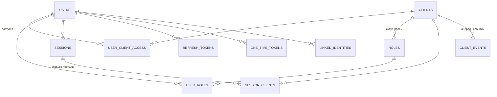

# SSO — архитектура
## Архитектура единой учётной записи экосистемы · v2.0 · июль 2026

> Центральный identity-провайдер для сети порталов: example.org, cv.example, shop.example, blog.example,
> календарьсобытий.рф, news.example и всех будущих. Один аккаунт, один профиль, одна админка.
> Домен — `sso.example` (техническая точка), пользовательский бренд — **SSO**
> (кнопка «Войти через SSO» звучит как продукт, а не как аббревиатура из ТЗ).
>
> Документ самодостаточен: его можно целиком скармливать Claude Code / нейросети как ТЗ.
> Версия 2.0 наследует принятые ранее протокольные решения (OAuth 2.0 + PKCE, RS256, popup-флоу,
> разделение «доступ ≠ роль») и достраивает всё остальное: инсталлятор, двухкликовое подключение
> сервисов с генерацией инструкции для ИИ, полную админку, дизайн-систему, наблюдаемость, миграцию.

---

## Оглавление

- §0. Резюме и зафиксированные решения
- §1. Среда, ограничения и суровая правда о cookies
- §2. Архитектура и потоки (вход, popup, выход, события)
- §3. Контракт протокола (endpoints, токены, ключи)
- §4. Модель данных — полный SQL
- §5. Карта экранов: пользователь, админка, системные
- §6. Подключение сервиса за два клика + файл для нейросети
- §7. Инсталлятор первого запуска
- §8. Безопасность и threat model
- §9. Доступы и роли
- §10. Дизайн-система (токены, бенто, вайрфреймы)
- §11. Логи, статусы, здоровье, cron
- §12. Структура кода и репозитория
- §13. Миграция существующих пользователей
- §14. Дорожная карта сборки (M0–M7)
- §15. Журнал решений и отвергнутые альтернативы
- Приложение A. Шаблон `integration.md` (генерируемый файл для ИИ)
- Приложение B. Шаблон `config/config.php`
- Приложение C. Словарь событий аудита
- Приложение D. Cron и серверные конфиги
- Приложение E. Чеклист запуска в прод

---

# §0. Резюме и зафиксированные решения

**Что строим.** Отдельное самостоятельное PHP-приложение — OpenID-провайдер (OP). Порталы —
клиенты (RP). Пользователь регистрируется один раз на sso.example; каждый портал получает его
личность через стандартный токен-обмен и держит собственную локальную сессию.

**Стек** (в духе экосистемы, совместим с остальными порталами сети):

| Слой | Выбор | Комментарий |
|---|---|---|
| Backend | PHP 8.2+ (цель — 8.3 на Ubuntu 24.04 / BrainyCP) | тонкий собственный роутер, без Laravel/Symfony |
| БД | MySQL 8 / MariaDB 10.6+ | utf8mb4, InnoDB, префикс таблиц настраиваемый |
| Composer | да, но только для «опасных» частей | `firebase/php-jwt`, `phpmailer/phpmailer` — и всё. TOTP, PKCE, роутер, миграции — свои (это по 30–150 строк) |
| Фронт | SSR-шаблоны + Alpine.js | без SPA, без Vite. Интерактив точечный |
| CSS | Tailwind 4 standalone CLI | собранный css коммитится, node в проде не нужен |
| Шрифты | Golos Text + JetBrains Mono | self-host woff2, кириллица первична |
| Крипто | openssl (RS256), sodium/openssl (шифрование секретов at rest), argon2id | всё штатное для PHP 8.3 |

**Ядро протокола — не изобретаем.** OAuth 2.0 Authorization Code + PKCE (S256), ID-token в стиле
OpenID Connect (JWT RS256), discovery, JWKS, back-channel logout. Причины: (а) протокол
аудирован двадцатилетием чужих ошибок; (б) любая нейросеть знает OIDC наизусть — значит,
генерируемая «инструкция для ИИ» из §6 будет исполняться без галлюцинаций; (в) при желании к
этому же серверу подключится что угодно стороннее.

**Зафиксировано ранее и остаётся в силе:**

| Решение | Суть |
|---|---|
| PKCE обязателен для всех | даже для confidential-клиентов — защита в глубину |
| Popup + postMessage на десктопе | popup — first-party контекст, сторонние cookies не нужны |
| Redirect-фоллбек на мобильных | popup блокируется/неудобен → полноэкранный редирект |
| Consent пропускается | все клиенты `is_trusted = 1` (свои порталы). Экран согласия существует, но включается только для будущих сторонних клиентов |
| `state` и `code_verifier` живут на сервере клиента | клиентский `sso.js` дергает свой бэкенд `/auth/sso/start`, не собирает URL в браузере |
| Доступ ≠ роль | доступ к порталу — отдельный факт (может отсутствовать); роль — что можно внутри портала |
| Делегированное администрирование | SSO-суперадмин видит всё; «админ клиента» — только пользователей своего портала |
| RS256 + ротация ключей | публичные ключи через JWKS с `kid` |
| Бан почти в реальном времени | access-token TTL 15 мин + событие `user.blocked` в back-channel + introspection для параноидальных мест |

**Новое в v2.0:** инсталлятор (§7), мастер подключения сервиса «в два клика» с генерацией
`integration.md` + PHP-кита + промпта для нейросети (§6), полная админка с дашбордом (§5.2),
унифицированный канал событий SSO→сервис (§2.4), дизайн-система «паспорт экосистемы» (§10),
страницы логов/статусов/ошибок (§11), миграция существующих баз пользователей (§13).

---

# §1. Среда, ограничения и суровая правда о cookies

## 1.1. Домены

Порталы живут на **разных регистрируемых доменах** (example.org ≠ shop.example ≠ blog.example ≠
xn--…рф). Это определяет всё:

1. **Общий cookie невозможен.** Точка. Единственный способ передать личность — токен-обмен
   через редиректы/попапы (то, что и делает OAuth).
2. **Тихий автологин через скрытый iframe умер.** Safari и Firefox блокируют сторонние cookies
   по умолчанию; Chrome их формально оставил, но строить архитектуру на этом — строить на песке.
   Следствие: «зашёл на shop.example и уже залогинен, ничего не нажимая» — не бывает между разными
   TLD. Честный паттерн: пользователь один раз жмёт «Войти» → топ-левел переход на sso.example
   (там cookie — first-party) → мгновенный возврат **без ввода пароля**. Один клик вместо нуля —
   цена, которую браузеры назначили всем, включая Google.
3. **Зона `*.example` — привилегированная.** Для cv.example, news.example cookie SSO с
   `Domain=.example` является first-party → там возможна и тихая проверка сессии
   (`prompt=none`), и мгновенный кросс-вход. В конфиге клиента флаг `same_site_family`.
4. FedCM (федеративный вход средствами браузера) — в бэклог Phase 3; API стабилизируется,
   спешить некуда.

## 1.2. Инфраструктура

- VPS Ubuntu 24.04 (BrainyCP), Apache/nginx — сниппеты обоих в Приложении D.
- PHP-FPM 8.2+; обязательные расширения: `pdo_mysql, openssl, mbstring, curl, json, gd`
  (аватары), желательно `sodium`. Инсталлятор проверяет всё это сам (§7).
- Исходящий SMTP (письма верификации/восстановления) — любой, настраивается в инсталляторе
  и админке, с кнопкой «отправить тестовое».
- HTTPS обязателен везде: OAuth без TLS — это не OAuth, а сеанс щедрости.

## 1.3. Роли доменов

| Домен | Роль |
|---|---|
| `sso.example` | канонический адрес OP: все endpoints, профиль, админка |
| `id.example` | опциональный человеческий алиас (301 → sso.example), если захочется красоты в адресной строке |
| порталы | каждый регистрируется как клиент со своими redirect URI |

---

# §2. Архитектура и потоки

## 2.1. Компоненты

```
[Браузер] ⇄ [Портал N (RP, свой бэкенд)] ⇄ [SSO (OP)] ⇄ [MySQL]
                                              │
                                              ├── SMTP (очередь писем)
                                              ├── storage/ (ключи, аватары, логи)
                                              └── cron (чистки, доставка событий, health)
```

SSO — единственный, кто видит пароль. Порталы паролей не хранят и не принимают никогда.

## 2.2. Канонический поток входа (Authorization Code + PKCE)

```mermaid
sequenceDiagram
    autonumber
    participant U as Браузер
    participant S as Портал (shop.example)
    participant ID as SSO (sso.example)
    U->>S: клик «Войти через SSO»
    S->>S: /auth/sso/start: генерирует state, nonce, code_verifier;<br/>кладёт в свою сессию; строит authorize_url
    S-->>U: authorize_url (redirect или popup)
    U->>ID: GET /authorize?...&code_challenge&state&nonce (+SSO-cookie, если есть)
    alt активной сессии SSO нет
        ID->>U: экран входа (пароль / magic-ссылка) [+ шаг 2FA]
    else сессия есть
        ID->>ID: доступ к клиенту есть? политика доступа? (см. §9)
    end
    ID-->>U: 302 → shop.example/sso/callback?code=…&state=…
    U->>S: GET /sso/callback
    S->>ID: POST /token (code, code_verifier, client_id, client_secret)
    ID-->>S: id_token (JWT) + access_token (+ refresh_token при offline_access)
    S->>S: проверка JWT: iss, aud, exp, nonce, подпись по JWKS →<br/>find-or-create локального юзера по sub → локальная сессия
    S-->>U: 302 на исходную страницу, пользователь залогинен
```

Ключевые свойства: `code` одноразовый, TTL 60 секунд, привязан к client_id + redirect_uri +
code_challenge + nonce + SSO-сессии. Повторное предъявление — ошибка `invalid_grant` + событие
в аудит (это сигнатура перехвата).

## 2.3. Popup-режим (десктоп) и фоллбек

Контракт виджета на стороне портала (входит в PHP-кит из §6):

```html
<script src="https://sso.example/assets/sso.js"
        data-client-id="cli_shop"
        data-start-url="/auth/sso/start" defer></script>
<button data-sso-login>Войти</button>
```

Логика `sso.js` (≈80 строк, отдаётся самим SSO — единая версия для всех порталов):

1. Клик → `fetch(startUrl)` на **свой** бэкенд → тот возвращает готовый `authorize_url`
   (state/verifier остались в серверной сессии портала, в JS не утекают).
2. Десктоп → `window.open(authorize_url + '&display=popup', 'sso', 'width=480,height=680')`.
   Popup — топ-левел контекст, cookie SSO работает как first-party.
3. Мобильный UA или заблокированный popup (`window.open === null`) → обычный
   `location = authorize_url`.
4. Внутри попапа флоу завершается на `callback` портала; callback в popup-режиме отвечает
   страницей-заглушкой: `opener.postMessage({type:'sso:done'}, origin); window.close()`.
5. Родительское окно по `sso:done` перезагружается / подтягивает сессию.
6. `display=popup` дополнительно переключает SSO на компактный лейаут без футера (§10.6).

## 2.4. Выход и канал событий SSO → портал

Единый механизм: **event-token** — короткоживущий JWT (RS256, те же ключи), который SSO
POST'ит на `backchannel_uri` каждого затронутого клиента. Back-channel logout из OIDC —
частный случай этого канала.

| Событие | Когда | Полезная нагрузка |
|---|---|---|
| `logout` | пользователь вышел «везде» или сессия отозвана | `sub`, `sid` (стандартный logout_token c claim `events`) |
| `user.blocked` | админ заблокировал | `sub` |
| `user.deleted` | аккаунт удалён/анонимизирован | `sub` |
| `user.updated` | сменил ФИО/аватар/email | `sub` + изменённые поля → портал обновляет локальный кэш профиля |
| `access.revoked` | у пользователя отозван доступ к этому порталу | `sub`, `mode`: `closed` («Закрыть» — учётную запись в архив) или `removed` («Убрать» — стереть) (v4.64) |
| `access.granted` | доступ к этому порталу открыли снова | `sub` → портал возвращает закрытого из архива (v4.64) |

Доставка: очередь `client_events` в БД → немедленная попытка + ретраи кроном
(1м, 5м, 30м, 6ч; после — пометка `failed`, видно в админке). Портал отвечает `200` — и точка;
редиректов и cookies в back-channel нет.

**Сценарий выхода глазами пользователя:** «Выйти» на портале → портал убивает локальную
сессию → редирект на `sso.example/logout?id_token_hint=…&post_logout_redirect_uri=…` → SSO
показывает выбор **«Выйти только здесь / Выйти везде»** → при «везде» гасит центральную
сессию и рассылает `logout` всем клиентам этой сессии → возврат на портал.

## 2.5. Проверка живости сессии порталом

- Обычный режим: портал доверяет своей локальной сессии; критичные операции сверяют
  `access_token` (TTL 15 мин) или дергают `POST /introspect`.
- Бан/разлогин прилетает событием из §2.4 — обычно быстрее, чем истечёт access-token.
- Для `*.example`-семьи доступен тихий `GET /authorize?...&prompt=none` (ответ
  `error=login_required` без UI, если сессии нет).

---

# §3. Контракт протокола

## 3.1. Endpoints

| Метод/путь | Назначение |
|---|---|
| `GET /.well-known/openid-configuration` | discovery: все URL, поддерживаемые scopes/алгоритмы |
| `GET /jwks.json` | публичные ключи (kid, n, e); кэшировать 24 ч, обновлять при неизвестном kid |
| `GET /authorize` | вход в флоу; параметры ниже |
| `POST /token` | обмен `authorization_code` → токены; `refresh_token` → новая пара |
| `GET/POST /userinfo` | claims по `Authorization: Bearer <access_token>` |
| `POST /introspect` | client_id+secret (Basic) + token → `{active, sub, exp, …}` |
| `POST /revoke` | отзыв refresh-token (и всей его семьи) |
| `GET /logout` | RP-initiated logout (`id_token_hint`, `post_logout_redirect_uri`, `state`) |
| `GET /assets/sso.js` | клиентский виджет (версионируется, `Cache-Control` + ETag) |

## 3.2. Параметры `/authorize`

| Параметр | Обязателен | Примечание |
|---|---|---|
| `response_type=code` | да | только code; implicit не существует |
| `client_id` | да | |
| `redirect_uri` | да | байт-в-байт из зарегистрированного списка; иначе — страница ошибки **без** редиректа |
| `scope` | да | `openid` + `profile email roles` (+`phone offline_access`) |
| `state` | да | вернётся как есть; портал обязан сверить |
| `nonce` | да | попадёт в id_token; портал обязан сверить |
| `code_challenge`, `code_challenge_method=S256` | да | PKCE, только S256 |
| `prompt` | нет | `login` (форс пароля), `none` (тихая проверка), `select_account` |
| `display=popup` | нет | компактный лейаут |
| `max_age` | нет | сек с момента auth_time; старше → переспросить пароль |
| `ui_locales` | нет | `ru` (деф.) / `en` |

## 3.3. Токены

| Токен | Формат | TTL | Смысл |
|---|---|---|---|
| `id_token` | JWT RS256 | 10 мин | личность для портала; портал проверяет подпись и claims, дальше живёт своей сессией |
| `access_token` | JWT RS256, `aud:"userinfo"` | 15 мин | пропуск к /userinfo и /introspect; НЕ хранится в БД (stateless) |
| `refresh_token` | opaque 64 байта, в БД только SHA-256 | 30 дней скользящие | только при `offline_access`; ротация при каждом использовании, `family_id` + детект повторного использования → отзыв всей семьи + аудит |

**Claims id_token:**

```
iss  = https://sso.example          sub = стабильный UUIDv4 пользователя (НЕ email!)
aud  = client_id                    exp/iat/auth_time/nonce/sid — стандарт
name, family_name, given_name, middle_name   ← да, отчество — полноправный claim
preferred_username, email, email_verified, picture (абс. URL), birthdate,
locale, zoneinfo, updated_at
roles    = ["user", "shop:editor", …]   ← глобальные + роли ЭТОГО клиента (§9)
verified = true|false                      ← «галочка» экосистемы (§5.1)
```

Правило для порталов, высеченное в камне: **локальный аккаунт матчится по `sub`, не по
email** — email меняется, sub вечен.

## 3.4. Ключи

- RSA-2048, генерируются инсталлятором в `storage/keys/` (0600), `kid = k<unixtime>`.
- Ротация из админки: новый ключ подписывает, старый остаётся в JWKS 48 ч (валидация
  «хвостов»), потом архивируется. Кнопка + автонапоминание раз в год.
- `client_secret` — 48 байт urlsafe; в БД только argon2id-хэш; показывается один раз.
- Секреты at rest (totp_secret и т.п.) шифруются APP_KEY (sodium secretbox, фоллбек
  openssl aes-256-gcm).

## 3.5. Ошибки OAuth

Формат стандартный: redirect с `error`, `error_description`, `state` — кроме невалидного
`client_id`/`redirect_uri`: тогда **никакого редиректа**, только собственная страница ошибки
SSO (§5.3) — иначе мы open-redirect-сервис. Словарь: `invalid_request`,
`unauthorized_client`, `access_denied` (в т.ч. «нет доступа к порталу», §9),
`invalid_grant`, `login_required`, `server_error`.

---

# §4. Модель данных — полный SQL

Все таблицы: `ENGINE=InnoDB DEFAULT CHARSET=utf8mb4 COLLATE=utf8mb4_unicode_ci`.
Префикс `sso_` настраивается в инсталляторе. Принципы: **токены и коды в БД только как
SHA-256-хэши**; IP — `VARBINARY(16)` (v4/v6); секреты at rest — шифротекст.

```sql
-- ПОЛЬЗОВАТЕЛИ ------------------------------------------------------------
CREATE TABLE sso_users (
  id                BIGINT UNSIGNED NOT NULL AUTO_INCREMENT,
  public_id         CHAR(36)     NOT NULL,             -- UUIDv4 = claim `sub`
  login             VARCHAR(64)  NULL,                 -- опционален, уникален
  email             VARCHAR(255) NOT NULL,
  email_verified_at DATETIME     NULL,
  phone             VARCHAR(20)  NULL,
  phone_verified_at DATETIME     NULL,
  password_hash     VARCHAR(255) NOT NULL,             -- argon2id
  last_name         VARCHAR(100) NULL,
  first_name        VARCHAR(100) NULL,
  middle_name       VARCHAR(100) NULL,                 -- отчество
  display_name      VARCHAR(150) NULL,
  avatar_path       VARCHAR(255) NULL,                 -- storage/avatars/{uid}/{size}.webp
  birthdate         DATE         NULL,
  locale            VARCHAR(10)  NOT NULL DEFAULT 'ru',
  timezone          VARCHAR(64)  NOT NULL DEFAULT 'Europe/Moscow',
  is_verified_badge TINYINT(1)   NOT NULL DEFAULT 0,   -- «галочка», выдаёт админ
  status            ENUM('pending','active','blocked','deleted') NOT NULL DEFAULT 'pending',
  totp_secret       VARBINARY(255) NULL,               -- шифротекст (APP_KEY)
  totp_enabled_at   DATETIME     NULL,
  failed_logins     TINYINT UNSIGNED NOT NULL DEFAULT 0,
  locked_until      DATETIME     NULL,
  created_at        DATETIME NOT NULL DEFAULT CURRENT_TIMESTAMP,
  updated_at        DATETIME NOT NULL DEFAULT CURRENT_TIMESTAMP ON UPDATE CURRENT_TIMESTAMP,
  last_login_at     DATETIME NULL,
  deleted_at        DATETIME NULL,                     -- soft delete, §5.1
  PRIMARY KEY (id),
  UNIQUE KEY uq_public_id (public_id),
  UNIQUE KEY uq_email (email),
  UNIQUE KEY uq_login (login),
  UNIQUE KEY uq_phone (phone),
  KEY ix_status (status)
) ENGINE=InnoDB;

CREATE TABLE sso_recovery_codes (               -- одноразовые коды 2FA
  id BIGINT UNSIGNED NOT NULL AUTO_INCREMENT,
  user_id BIGINT UNSIGNED NOT NULL,
  code_hash CHAR(64) NOT NULL,
  used_at DATETIME NULL,
  PRIMARY KEY (id), KEY ix_user (user_id),
  CONSTRAINT fk_rc_user FOREIGN KEY (user_id) REFERENCES sso_users(id) ON DELETE CASCADE
) ENGINE=InnoDB;

-- КЛИЕНТЫ (ПОРТАЛЫ) --------------------------------------------------------
CREATE TABLE sso_clients (
  id                 BIGINT UNSIGNED NOT NULL AUTO_INCREMENT,
  client_id          VARCHAR(48)  NOT NULL,            -- 'cli_' + random
  client_secret_hash VARCHAR(255) NOT NULL,
  name               VARCHAR(100) NOT NULL,
  slug               VARCHAR(50)  NOT NULL,
  description        VARCHAR(255) NULL,
  icon_path          VARCHAR(255) NULL,
  base_url           VARCHAR(255) NOT NULL,
  redirect_uris      JSON NOT NULL,                    -- ["https://…/sso/callback.php"]
  post_logout_uris   JSON NOT NULL,
  backchannel_uri    VARCHAR(255) NULL,                -- события §2.4
  allowed_scopes     JSON NOT NULL,                    -- деф. ["openid","profile","email","roles"]
  is_trusted         TINYINT(1) NOT NULL DEFAULT 1,    -- свои порталы: consent пропускается
  same_site_family   TINYINT(1) NOT NULL DEFAULT 0,    -- *.example: разрешён prompt=none
  access_policy      ENUM('open','approval','invite') NOT NULL DEFAULT 'open', -- §9
  require_2fa        TINYINT(1) NOT NULL DEFAULT 0,    -- step-up для чувствительных порталов
  is_active          TINYINT(1) NOT NULL DEFAULT 1,
  sort_order         INT NOT NULL DEFAULT 0,           -- порядок на «странице сервисов»
  created_at DATETIME NOT NULL DEFAULT CURRENT_TIMESTAMP,
  updated_at DATETIME NOT NULL DEFAULT CURRENT_TIMESTAMP ON UPDATE CURRENT_TIMESTAMP,
  PRIMARY KEY (id), UNIQUE KEY uq_client_id (client_id), UNIQUE KEY uq_slug (slug)
) ENGINE=InnoDB;

-- ДОСТУП К ПОРТАЛУ (доступ ≠ роль!) ---------------------------------------
CREATE TABLE sso_user_client_access (
  user_id BIGINT UNSIGNED NOT NULL,
  client_id BIGINT UNSIGNED NOT NULL,
  status ENUM('active','pending','blocked') NOT NULL DEFAULT 'active',
  granted_by BIGINT UNSIGNED NULL,                     -- NULL = авто по политике 'open'
  first_login_at DATETIME NULL,
  last_login_at  DATETIME NULL,
  created_at DATETIME NOT NULL DEFAULT CURRENT_TIMESTAMP,
  PRIMARY KEY (user_id, client_id),
  KEY ix_client (client_id),
  CONSTRAINT fk_uca_user   FOREIGN KEY (user_id)   REFERENCES sso_users(id)   ON DELETE CASCADE,
  CONSTRAINT fk_uca_client FOREIGN KEY (client_id) REFERENCES sso_clients(id) ON DELETE CASCADE
) ENGINE=InnoDB;

-- РОЛИ ----------------------------------------------------------------------
CREATE TABLE sso_roles (
  id BIGINT UNSIGNED NOT NULL AUTO_INCREMENT,
  client_id BIGINT UNSIGNED NULL,                      -- NULL = глобальная роль
  slug VARCHAR(50) NOT NULL,                           -- 'superadmin','user','editor'…
  name VARCHAR(100) NOT NULL,
  description VARCHAR(255) NULL,
  is_system TINYINT(1) NOT NULL DEFAULT 0,             -- superadmin/user не удалить
  created_at DATETIME NOT NULL DEFAULT CURRENT_TIMESTAMP,
  PRIMARY KEY (id), UNIQUE KEY uq_scope_slug (client_id, slug),
  CONSTRAINT fk_role_client FOREIGN KEY (client_id) REFERENCES sso_clients(id) ON DELETE CASCADE
) ENGINE=InnoDB;

CREATE TABLE sso_user_roles (
  user_id BIGINT UNSIGNED NOT NULL,
  role_id BIGINT UNSIGNED NOT NULL,
  granted_by BIGINT UNSIGNED NULL,
  created_at DATETIME NOT NULL DEFAULT CURRENT_TIMESTAMP,
  PRIMARY KEY (user_id, role_id),
  CONSTRAINT fk_ur_user FOREIGN KEY (user_id) REFERENCES sso_users(id) ON DELETE CASCADE,
  CONSTRAINT fk_ur_role FOREIGN KEY (role_id) REFERENCES sso_roles(id) ON DELETE CASCADE
) ENGINE=InnoDB;

-- СЕССИИ И ТОКЕНЫ -----------------------------------------------------------
CREATE TABLE sso_sessions (                            -- центральные сессии SSO
  id BIGINT UNSIGNED NOT NULL AUTO_INCREMENT,
  user_id BIGINT UNSIGNED NOT NULL,
  token_hash CHAR(64) NOT NULL,                        -- sha256 от значения cookie
  ip VARBINARY(16) NULL,
  user_agent VARCHAR(255) NULL,
  device_label VARCHAR(100) NULL,                      -- 'Chrome · Windows'
  is_remembered TINYINT(1) NOT NULL DEFAULT 0,
  created_at DATETIME NOT NULL DEFAULT CURRENT_TIMESTAMP,
  last_seen_at DATETIME NOT NULL DEFAULT CURRENT_TIMESTAMP,
  expires_at DATETIME NOT NULL,
  revoked_at DATETIME NULL,
  PRIMARY KEY (id), UNIQUE KEY uq_token (token_hash), KEY ix_user (user_id),
  CONSTRAINT fk_sess_user FOREIGN KEY (user_id) REFERENCES sso_users(id) ON DELETE CASCADE
) ENGINE=InnoDB;

CREATE TABLE sso_session_clients (                     -- в какие порталы входили из сессии
  id BIGINT UNSIGNED NOT NULL AUTO_INCREMENT,
  session_id BIGINT UNSIGNED NOT NULL,
  client_id BIGINT UNSIGNED NOT NULL,
  sid CHAR(36) NOT NULL,                               -- per-client session id → в id_token и logout_token
  created_at DATETIME NOT NULL DEFAULT CURRENT_TIMESTAMP,
  logged_out_at DATETIME NULL,
  PRIMARY KEY (id), UNIQUE KEY uq_sid (sid), KEY ix_session (session_id), KEY ix_client (client_id),
  CONSTRAINT fk_sc_sess   FOREIGN KEY (session_id) REFERENCES sso_sessions(id) ON DELETE CASCADE,
  CONSTRAINT fk_sc_client FOREIGN KEY (client_id)  REFERENCES sso_clients(id)  ON DELETE CASCADE
) ENGINE=InnoDB;

CREATE TABLE sso_auth_codes (
  id BIGINT UNSIGNED NOT NULL AUTO_INCREMENT,
  code_hash CHAR(64) NOT NULL,
  client_id BIGINT UNSIGNED NOT NULL,
  user_id BIGINT UNSIGNED NOT NULL,
  session_id BIGINT UNSIGNED NOT NULL,
  redirect_uri VARCHAR(255) NOT NULL,
  scope VARCHAR(255) NOT NULL,
  nonce VARCHAR(255) NULL,
  code_challenge VARCHAR(128) NOT NULL,
  auth_time DATETIME NOT NULL,
  expires_at DATETIME NOT NULL,                        -- now + 60 сек
  consumed_at DATETIME NULL,
  PRIMARY KEY (id), UNIQUE KEY uq_code (code_hash), KEY ix_exp (expires_at)
) ENGINE=InnoDB;

CREATE TABLE sso_refresh_tokens (
  id BIGINT UNSIGNED NOT NULL AUTO_INCREMENT,
  token_hash CHAR(64) NOT NULL,
  family_id CHAR(36) NOT NULL,                         -- детект повторного использования
  user_id BIGINT UNSIGNED NOT NULL,
  client_id BIGINT UNSIGNED NOT NULL,
  session_id BIGINT UNSIGNED NULL,
  scope VARCHAR(255) NOT NULL,
  expires_at DATETIME NOT NULL,
  rotated_at DATETIME NULL,
  revoked_at DATETIME NULL,
  created_at DATETIME NOT NULL DEFAULT CURRENT_TIMESTAMP,
  PRIMARY KEY (id), UNIQUE KEY uq_token (token_hash), KEY ix_family (family_id), KEY ix_user (user_id)
) ENGINE=InnoDB;

-- ОДНОРАЗОВЫЕ ТОКЕНЫ (почта и пр.) -----------------------------------------
CREATE TABLE sso_one_time_tokens (
  id BIGINT UNSIGNED NOT NULL AUTO_INCREMENT,
  user_id BIGINT UNSIGNED NOT NULL,
  type ENUM('email_verify','password_reset','email_change','login_link','account_delete','client_setup') NOT NULL,
  token_hash CHAR(64) NOT NULL,
  payload JSON NULL,                                   -- напр. {"new_email": "…"}
  expires_at DATETIME NOT NULL,
  consumed_at DATETIME NULL,
  created_at DATETIME NOT NULL DEFAULT CURRENT_TIMESTAMP,
  PRIMARY KEY (id), UNIQUE KEY uq_token (token_hash), KEY ix_user_type (user_id, type)
) ENGINE=InnoDB;

-- ВНЕШНИЕ ЛИЧНОСТИ (Phase 2: Telegram/VK/…) --------------------------------
CREATE TABLE sso_linked_identities (
  id BIGINT UNSIGNED NOT NULL AUTO_INCREMENT,
  user_id BIGINT UNSIGNED NOT NULL,
  provider ENUM('telegram','vk','yandex','github','google') NOT NULL,
  provider_uid VARCHAR(191) NOT NULL,
  meta JSON NULL,
  created_at DATETIME NOT NULL DEFAULT CURRENT_TIMESTAMP,
  PRIMARY KEY (id), UNIQUE KEY uq_provider_uid (provider, provider_uid), KEY ix_user (user_id),
  CONSTRAINT fk_li_user FOREIGN KEY (user_id) REFERENCES sso_users(id) ON DELETE CASCADE
) ENGINE=InnoDB;

-- СОБЫТИЯ ДЛЯ ПОРТАЛОВ (§2.4) ----------------------------------------------
CREATE TABLE sso_client_events (
  id BIGINT UNSIGNED NOT NULL AUTO_INCREMENT,
  client_id BIGINT UNSIGNED NOT NULL,
  event VARCHAR(32) NOT NULL,                          -- logout | user.blocked | …
  payload JSON NOT NULL,
  status ENUM('pending','sent','failed') NOT NULL DEFAULT 'pending',
  attempts TINYINT UNSIGNED NOT NULL DEFAULT 0,
  next_attempt_at DATETIME NULL,
  last_error VARCHAR(255) NULL,
  created_at DATETIME NOT NULL DEFAULT CURRENT_TIMESTAMP,
  sent_at DATETIME NULL,
  PRIMARY KEY (id), KEY ix_status_next (status, next_attempt_at)
) ENGINE=InnoDB;

-- НАБЛЮДАЕМОСТЬ -------------------------------------------------------------
CREATE TABLE sso_audit_log (
  id BIGINT UNSIGNED NOT NULL AUTO_INCREMENT,
  created_at DATETIME NOT NULL DEFAULT CURRENT_TIMESTAMP,
  actor_user_id BIGINT UNSIGNED NULL,                  -- кто сделал (NULL = система/аноним)
  on_user_id BIGINT UNSIGNED NULL,                     -- над кем
  client_id BIGINT UNSIGNED NULL,
  event VARCHAR(48) NOT NULL,                          -- словарь — Приложение C
  ip VARBINARY(16) NULL,
  user_agent VARCHAR(255) NULL,
  meta JSON NULL,                                      -- без секретов. Никогда.
  PRIMARY KEY (id), KEY ix_event_time (event, created_at),
  KEY ix_on_user (on_user_id, created_at), KEY ix_actor (actor_user_id, created_at)
) ENGINE=InnoDB;

CREATE TABLE sso_rate_limits (
  bucket VARCHAR(96) NOT NULL,                         -- 'login:ip:<hash>' / 'login:acct:<id>'
  points SMALLINT UNSIGNED NOT NULL DEFAULT 0,
  window_start DATETIME NOT NULL,
  PRIMARY KEY (bucket)
) ENGINE=InnoDB;

CREATE TABLE sso_mail_queue (
  id BIGINT UNSIGNED NOT NULL AUTO_INCREMENT,
  to_email VARCHAR(255) NOT NULL,
  subject VARCHAR(255) NOT NULL,
  body_html MEDIUMTEXT NOT NULL,
  body_text MEDIUMTEXT NOT NULL,
  status ENUM('pending','sent','failed') NOT NULL DEFAULT 'pending',
  attempts TINYINT UNSIGNED NOT NULL DEFAULT 0,
  last_error VARCHAR(255) NULL,
  created_at DATETIME NOT NULL DEFAULT CURRENT_TIMESTAMP,
  sent_at DATETIME NULL,
  PRIMARY KEY (id), KEY ix_status (status)
) ENGINE=InnoDB;

-- СИСТЕМНОЕ -----------------------------------------------------------------
CREATE TABLE sso_settings (                            -- всё, что правится из админки
  `key` VARCHAR(64) NOT NULL,
  `value` TEXT NULL,
  updated_at DATETIME NOT NULL DEFAULT CURRENT_TIMESTAMP ON UPDATE CURRENT_TIMESTAMP,
  PRIMARY KEY (`key`)
) ENGINE=InnoDB;

CREATE TABLE sso_migrations (
  version VARCHAR(32) NOT NULL,                        -- '2026_07_18_0001'
  applied_at DATETIME NOT NULL DEFAULT CURRENT_TIMESTAMP,
  PRIMARY KEY (version)
) ENGINE=InnoDB;
```

**ER-скелет** (детали — в SQL выше):



---

# §5. Карта экранов

## 5.1. Пользовательская зона

| Путь | Экран | Что важно |
|---|---|---|
| `/login` | Вход | email/логин + пароль; ссылки «Забыли пароль», «Войти по ссылке» (magic link на почту); контекст клиента сверху: «Вы входите в **Магазин**» + иконка портала — антифишинговый якорь; чекбокс «Запомнить меня» (сессия 30 дней вместо 12 часов) |
| `/login/2fa` | Второй шаг | 6-значный TOTP (OTP-инпут из 6 ячеек), ссылка «использовать код восстановления»; 5 попыток → откат на шаг пароля |
| `/register` | Регистрация | имя, email, пароль (индикатор силы), согласие с политикой; после — экран «подтвердите почту» (аккаунт в статусе `pending`, вход разрешён, но порталам отдаётся `email_verified=false`) |
| `/verify/{token}` | Подтверждение почты | активирует, редиректит обратно во флоу, если пришли из `/authorize` |
| `/recover` → `/recover/{token}` | Восстановление | запрос ссылки → форма нового пароля; ответы формы одинаковы для существующего и несуществующего email (антиперебор); успешный сброс гасит все сессии, кроме новой |
| `/consent` | Согласие | только для `is_trusted=0`: список scopes человеческим языком, «Разрешить/Отмена» |
| `/profile` | Карточка профиля | бенто (§10.5): большая ID-карта (аватар, ФИО, @login, галочка `verified`), плитки: безопасность, активные сессии (превью 3), сервисы, последние входы |
| `/profile/edit` | Редактирование | ФИО, отображаемое имя, ДР, аватар (drag&drop, кроп 1:1, конверсия в webp 512/128/32, дефолт — инициалы на градиенте от hash(sub)) |
| `/profile/security` | Безопасность | смена пароля (с текущим паролем); включение 2FA: QR (otpauth://) + ручной секрет → подтверждение кодом → выдача 10 recovery-кодов (показ один раз, кнопка «скачать .txt»); «оценка защищённости» — прогресс из фактов: пароль svež, 2FA, почта подтверждена |
| `/profile/sessions` | Устройства | список центральных сессий: устройство, IP (частично замаскирован), город по GeoIP-lite (опц.), «текущая»; кнопки «Завершить» / «Завершить все остальные» — с рассылкой `logout` порталам |
| `/profile/services` | Мои сервисы | сетка порталов экосистемы: подключён/нет, дата первого и последнего входа, роли в нём, «Перейти»; для `access_policy≠open` — статус заявки; для недоверенных клиентов — «Отозвать доступ» |
| `/profile/settings` | Настройки аккаунта | смена email (подтверждение на **новый** + уведомление на старый с кнопкой «это не я» — заморозка смены и сессий), смена логина, язык, часовой пояс; **удаление аккаунта**: пароль → soft-delete с холдом 14 дней (письмо с отменой) → анонимизация (email→hash, ФИО→NULL, аватар удалён), аудит сохраняет целостность |
| `/logout` | Выход | выбор «только здесь / везде» (§2.4) |
| `/goodbye` | После удаления | вежливая точка + срок отмены |

Каждый экран имеет 4 состояния: loading (скелетоны), empty, error (inline), success (тосты).
Правило текстов: без пассивного залога, кнопка называет действие («Сохранить изменения», не
«Отправить»).

## 5.2. Админка `/admin`

Доступ: глобальные `superadmin`/`admin` — всё; `client_admin` (роль со скоупом клиента) —
только свой портал: его пользователи, его роли, его логи. Меню строится по правам.

| Путь | Экран | Содержимое |
|---|---|---|
| `/admin` | Дашборд | бенто: KPI-плитки (пользователи всего/новые за 7д, входы сегодня, неудачные входы — sparkline, активные сессии, порталов подключено), график регистраций 30 дней (SVG, без чарт-библиотек), лента последних событий аудита, мини-статус здоровья (§11) |
| `/admin/users` | Пользователи | таблица: аватар, ФИО, email, статус, роли, порталы, последний вход; поиск по email/логину/ФИО/sub; фильтры: статус, роль, портал, «с 2FA», «email не подтверждён»; массовые действия нет (намеренно — от греха) |
| `/admin/users/{id}` | Карточка пользователя | вкладки: Профиль (просмотр+правка), Доступы (порталы + роли, выдать/отозвать), Сессии (+«разлогинить везде»), Аудит (его события), Действия: заблокировать (событие `user.blocked` порталам), подтвердить email вручную, сбросить пароль (генерирует ссылку — пароль руками не задаётся никогда), удалить; **имперсонизация** — только superadmin, плашка «Вы смотрите как X» на всех страницах, каждый шаг в аудит, смена пароля/почты в этом режиме запрещена |
| `/admin/clients` | Порталы | карточки клиентов: имя, URL, статус, пользователей, последняя активность; кнопка «Подключить сервис» → мастер §6 |
| `/admin/clients/{id}` | Карточка портала | реквизиты (client_id, редактор redirect/logout/backchannel URI), «Перевыпустить секрет» (старый живёт 24 ч для бесшовной смены), политика доступа, require_2fa, роли этого портала (CRUD), доставка событий (последние + ретраи), повторная генерация `integration.md`/кита |
| `/admin/roles` | Роли | глобальные и по порталам; системные (`superadmin`, `user`) защищены от удаления |
| `/admin/logs` | Аудит | браузер `audit_log`: фильтры по событию/пользователю/порталу/IP/датам, экспорт CSV |
| `/admin/logs/errors` | Ошибки приложения | просмотр `storage/logs/app-*.log` (JSON-lines, tail с пагинацией), фильтр по уровню |
| `/admin/logs/mail` | Почта | очередь: pending/sent/failed, повторить, посмотреть письмо |
| `/admin/settings` | Настройки | вкладки: Брендинг (название, логотип, акцентный цвет → CSS-переменная), SMTP (+«отправить тест»), Политики (мин. длина пароля, лимиты попыток, TTL сессий/токенов), Ключи (активный kid, кнопка ротации, история), Обслуживание (режим maintenance с allowlist IP) |
| `/admin/health` | Здоровье | §11.3 |
| `/admin/tools` | Инструменты | импорт пользователей (§13), очистка кэшей, запуск pending-миграций после обновления кода |

## 5.3. Системные страницы

| Путь | Назначение |
|---|---|
| `/install` | инсталлятор (§7); после установки намертво заблокирован lock-файлом |
| `/cron?token=…` | точка для планировщика (альтернатива — CLI `php cron.php`); токен из конфига |
| `/status` | публичный лаконичный статус: `{"status":"ok","time":…}` + человекочитаемая страница; деградация — `"degraded"` + какие подсистемы (без деталей) |
| Ошибки 400/403/404/419/429/500 | фирменные страницы в общем стиле; 419 — протухший CSRF («Форма устарела, обновите страницу»); 429 — «Слишком часто, подождите N сек»; 500 — ID инцидента, по которому событие ищется в логах |
| OAuth-ошибка | отдельный шаблон для невалидного client_id/redirect_uri: показываем на месте, никуда не редиректим (§3.5) |

## §5.3. Замер админки (v4.7)

Перед тем как заказывать перерисовку админки, её замерили: двадцать два экрана,
три ширины, счёт по разметке и по живой раскладке. Вывод обратный ожидаемому —
**перерисовывать нечего**, есть три выброса.

Что мерили и что вышло:

| Что проверяли | Результат |
|---|---|
| Едет ли страница вбок на 375px | ни одна из 22 |
| Элементы за краем вне полосы прокрутки | ноль на всех |
| Высота экрана на 1280px | 1–1.3 экрана у 12 из 15; выбросы ниже |
| Липкая полоса сохранения | стоит везде, где есть что сохранять |

Три выброса, и только они и чинились:

1. **Журнал ошибок** — 26.8 экрана, 200 карточек. Живой файл: 460 записей за
   день = 6 разных сообщений. Свёрнуто по сигнатуре, стало 1 экран.
2. **Системный раздел** — 2.6 экрана из пяти одинаковых плит во всю ширину.
   Сведения встали в два столбца, действия остались широкими.
3. **Аудит** — 3.1 экрана. Не трогали: это лента событий, её длина естественна.

Два жанра списков — **намеренные**, и сводить их к одному нельзя:

- **галерея карточек** там, где объектов немного и у каждого своё лицо
  (порталы, организации): видно состояние, знак, адрес;
- **таблица-в-карточки** там, где объектов много и важна сверка по столбцам
  (пользователи, роли, аудит): на телефоне строки сами становятся карточками
  через `data-label`, на широком экране остаются таблицей.

Отсюда правило на будущее: **новый экран админки выбирает жанр по числу
объектов и по тому, сверяют их или разглядывают** — а не по тому, как выглядит
соседний раздел.

## §5.4. Оформление сайта (v4.8)

`/admin/appearance` — отдельный раздел для того, что видит **не вошедший**
человек. Граница проведена не по размеру и не по удобству, а по тому, кто это
видит:

| Где | Что там | Кто видит |
|---|---|---|
| Настройки → Брендинг | имя установки, акцент, логотип, favicon | все: админка, профиль, письма |
| **Оформление сайта** | витрина на главной, состав формы входа, обложка панели | только посторонний: главная и `/login` |

До этого граница отсутствовала: обложка панели входа лежала во вкладке
«Брендинг» рядом с логотипом и выглядела его продолжением, витрина включалась
сама по галочке в карточке **каждого** портала, а состав формы входа не
настраивался вовсе — показывалось всё, что система умеет.

Три решения:

1. **Состав витрины правится списком**, а не обходом карточек: решение «что
   показать постороннему» принимают разом, глядя на весь перечень. Витрина
   требует двух условий сразу — тумблер владельца и хотя бы один отмеченный
   портал; пустая витрина хуже, чем сразу форма входа.
2. **Способы входа выключаются по одному**, все включены по умолчанию —
   обновление не меняет поведение ни на пиксель (§1). Выключить **все** нельзя:
   проверка стоит до записи, иначе выход из положения был бы только через базу.
   Соцвход не считается способом, пока не настроен ни один провайдер.
3. **Предпросмотр панели стоит рядом с формой**, а не «откройте в новой вкладке
   и сверьте»: панель видно на чужих сайтах, и ошибиться в ней дороже всего.

---

# §6. Подключение сервиса за «два клика»

Требование дословно: новый портал подключается почти без усилий, а на выходе — файл-инструкция,
которую скармливаешь нейросети, и она пишет интеграцию на стороне сервиса. Реализуем буквально.

## 6.1. Мастер в админке (`/admin/clients` → «Подключить сервис»)

**Шаг 1 — анкета (30 секунд):**

| Поле | Пример | Примечание |
|---|---|---|
| Название | `Магазин` | покажется пользователю: «Вы входите в Магазин» |
| Базовый URL | `https://shop.example` | из него автозаполняются поля ниже |
| Redirect URI | `https://shop.example/sso/callback.php` | предзаполнено, можно править; несколько строк — по одной на строку |
| Post-logout URI | `https://shop.example/` | куда вернуть после выхода |
| Backchannel URI | `https://shop.example/sso/backchannel.php` | приём событий (§2.4); можно оставить пустым и добавить позже |
| Доверенный (first-party) | ☑ | пропуск consent-экрана |
| Семейство `*.example` | ☐ | включает privileged-зону (§1.2): `prompt=none` разрешён |
| Политика доступа | `open` / `approval` / `invite` | §9.1 |
| Требовать 2FA | ☐ | для чувствительных порталов |

**Шаг 2 — реквизиты и артефакты (второй клик):**

Система создаёт запись в `sso_clients` и показывает:

- `client_id` — вида `cli_9f3k…` (копируемое поле);
- `client_secret` — **показывается один раз**, в БД остаётся только argon2id-хэш; рядом красная plashka «Сохраните сейчас»;
- кнопка **[Скачать integration.md]** — инструкция для нейросети (Приложение A, заполненная реальными значениями);
- кнопка **[Скачать PHP-kit (.zip)]** — готовый минимальный код интеграции (§6.2);
- кнопка **[Скопировать промпт]** — однострочник: «Вот файл integration.md, подключи сайт к SSO по этой спецификации, ничего не выдумывай сверх неё» + содержимое файла;
- чекбокс «Включить client_secret в файлы» — **по умолчанию выключен** (в файлах плейсхолдер `{{CLIENT_SECRET}}`); включаешь осознанно, если качаешь по HTTPS себе и сразу кладёшь в конфиг;
- `setup_token` — одноразовая ссылка для назначения первого `client_admin` портала (жмёт владелец портала, входит через SSO, получает роль).

Повторная генерация обоих артефактов — в любой момент из карточки клиента (`/admin/clients/{id}`).

## 6.2. Состав PHP-кита

Цель кита: интеграция работает «из коробки» на типовом PHP-хостинге портала, нейросети остаётся
подогнать пути и вписать логику «что делать с пользователем после входа». Всё — плоские файлы, без Composer.

```
sso/
├── config.php        # issuer, client_id, client_secret, redirect_uri, пути
├── SsoClient.php     # один класс ~300 строк: discovery, PKCE, обмен кода,
│                     # проверка id_token (подпись по JWKS, iss/aud/exp/nonce),
│                     # userinfo, refresh, кэш JWKS в файл на 24 ч
├── login.php         # старт: генерирует state+verifier в сессию, редирект на /authorize
├── callback.php      # приём code: проверки, обмен, создание локальной сессии,
│                     # матчинг ЛОКАЛЬНОГО аккаунта по sub (не по email!)
├── logout.php        # локальный выход + редирект на SSO /logout (по желанию «везде»)
├── backchannel.php   # приёмник событий §2.4: проверка event-token, обработка
│                     # logout / user.blocked / user.updated / user.deleted
└── widget.php        # include-сниппет: кнопка «Войти через SSO» или
                      # аватар+имя+меню, если вошёл; подключает /assets/sso.js для popup
```

Правила внутри кита жёстко повторяют §8: `hash_equals` для сравнений, PDO prepared, никакого
логирования токенов. Матчинг по `sub` — в киты вшито и в integration.md выделено капсом,
потому что это ошибка №1 всех самодельных интеграций.

## 6.3. Почему и файл, и кит

`integration.md` — спецификация: годится для любой платформы (PHP, Node, что угодно) и любой
нейросети. Кит — референс-реализация для мажоритарного случая (твои порталы — PHP). Нейросеть,
получившая и то и другое, почти не имеет пространства для галлюцинаций: спека говорит «что»,
кит показывает «как». Это и есть требуемая фича «в два клика», доведённая до конца.

---

# §7. Инсталлятор (`/install`)

Требование: настройка через UI, «чтобы не копаться в коде». Инсталлятор — первое, что видит
администратор, и последнее, что имеет право выглядеть сырым.

## 7.0. Механика

- Всё в `/install/` (index.php + шаги). Работает без БД и без конфига — на чистом PHP.
- Если существует `config/installed.lock` — инсталлятор отдаёт 403 и ссылку на `/login`. Точка.
- Каждый шаг — отдельный POST с CSRF-токеном в сессии установщика; назад/вперёд можно ходить.
- Язык интерфейса: ru (en — Phase 2, M7).

## 7.1. Шаги

**Шаг 0 — приветствие.** Логотип, «Установка SSO», версия, ссылка на этот документ.

**Шаг 1 — проверка окружения.** Таблица: PHP ≥ 8.2, расширения (`pdo_mysql`, `openssl`,
`mbstring`, `curl`, `json`, `gd` — обязательные; `sodium` — желательное, без него шифрование
секретов на openssl), права записи на `storage/` и `config/`, HTTPS (предупреждение, не блокер —
вдруг ставят за прокси). Каждая строка: ✅ / ⚠️ / ❌ + человеческая подсказка «что сделать».
Кнопка «Далее» активна только без ❌.

**Шаг 2 — база данных.** Поля: хост (`localhost`), порт (`3306`), имя БД, пользователь, пароль,
префикс таблиц (`sso_`). Кнопка **«Проверить подключение»** — AJAX, живой ответ:
«Подключился, MySQL 8.0.36, кодировка ok» или конкретная ошибка («Access denied» ≠ «Unknown database» —
разные подсказки). «Далее» — только после успешной проверки.

**Шаг 3 — миграции.** Прогресс применения SQL из `/migrations` по порядку, лог на экране.
Если таблицы с префиксом уже есть — стоп и вопрос: «Обнаружена установка. Обновить схему / Стереть и поставить заново / Отмена».

**Шаг 4 — криптография.** Автоматически: генерация RSA-2048 пары в `storage/keys/`
(`k<unixtime>.pem` + pub, права 0600), генерация `APP_KEY` (32 случайных байта, base64) для
шифрования секретов at rest, запись `config/config.php` из шаблона (Приложение B). На экране —
только «Ключи созданы, kid=k1737…», без самих ключей.

**Шаг 5 — суперадмин.** ФИО, email, логин, пароль (валидация политикой из §8 сразу).
Создаётся с ролью `superadmin`, `email_verified=1`, is_verified_badge=1.

**Шаг 6 — базовые настройки.** Issuer URL (автоопределён из запроса, можно поправить),
название инсталляции, SMTP (хост/порт/шифрование/логин/пароль/from) + кнопка «Отправить тестовое
письмо» на email суперадмина; можно «Пропустить, настрою потом» (письма лягут в очередь).

**Финал.** Экран «Готово»: строка для crontab (Приложение D), сниппеты Apache/.htaccess и nginx,
кнопка «Перейти в админку». Создаётся `config/installed.lock`, инсталлятор закрывается навсегда.
Рекомендация красным: «Удалите каталог /install с сервера» (+ пункт в чеклисте Приложения E,
и `/admin/health` будет ныть, пока каталог на месте).

---

# §8. Безопасность

Единая точка входа — единая точка отказа. Поэтому раздел длинный, а правила — без «потом докрутим».

## 8.1. Политики (всё конфигурируемо в `/admin/settings` → Политики)

| Политика | Значение по умолчанию |
|---|---|
| Пароль | ≥ 12 символов, без принудительных «спецсимвол+цифра» (длина важнее зоопарка), проверка на топ-10k утёкших (встроенный список; HIBP k-anonymity API — опция, выключена) |
| Хэширование | `argon2id`, memory 64 MB, time 4, threads 2 (подстройка под VPS в конфиге) |
| Lockout аккаунта | 10 неудач подряд → блок на 15 мин (`locked_until`); сбрасывается успешным входом или сбросом пароля |
| Rate limit: `/login` | 5/мин с IP и 10/час на аккаунт |
| Rate limit: `/register` | 3/час с IP |
| Rate limit: `/recover` | 3/час с IP и на email |
| Rate limit: `/token` | 60/мин на client_id |
| Rate limit: `/authorize` | 30/мин с IP (антикарусель) |
| Сессия SSO | 12 ч; с «запомнить меня» — 30 дней; `regenerate_id` после логина и повышения привилегий |
| 2FA | опциональна для всех; **обязательна** для ролей `superadmin`/`admin`/`client_admin` (без TOTP в админку не пустит — сначала настрой) |

Rate limits — на `sso_rate_limits` (bucket в PK, атомарный `INSERT … ON DUPLICATE KEY UPDATE`),
без Redis: на наших масштабах MySQL справляется, а зависимость минус одна.

## 8.2. Threat model — коротко и по делу

| Угроза | Контрмера |
|---|---|
| CSRF | токен на каждую форму, `SameSite=Lax`, проверка `Origin` на POST |
| Credential stuffing | rate limits + lockout + одинаковые ответы («Неверный логин или пароль» всегда) |
| Фишинг «поддельный SSO» | вход только на одном origin; контекст «Вы входите в X» приучает глаз; порталы никогда не рисуют форму пароля |
| Перехват authorization code | PKCE S256 обязателен, code TTL 60 с, одноразовый, привязан к client+redirect+challenge; повтор = `invalid_grant` + аудит |
| Кража access token | TTL 15 мин, `aud` ограничен, stateless — но короткоживущий |
| Кража refresh token | ротация на каждый refresh, reuse-detection гасит всю family, событие в аудит |
| Session hijacking | `regenerate_id`, cookie `Secure+HttpOnly+SameSite=Lax`, привязка «мягкая» к UA (смена → событие в аудит, не разлогин: мобильные браузеры любят менять UA) |
| Open redirect | `redirect_uri` — точное сравнение со списком, никаких wildcard/префиксов; `post_logout` — так же |
| XSS | автоэкранирование `esc()` во View по умолчанию, CSP с nonce (`script-src 'self' 'nonce-…'`), запрет inline-обработчиков |
| SQL-инъекции | только PDO prepared statements, конкатенация SQL с данными запрещена стилем кода |
| User enumeration | одинаковые ответы и близкие тайминги на register/recover («Если email существует — письмо отправлено») |
| Вредоносный upload | аватар: перекодирование через GD в webp (EXIF и полезная нагрузка умирают), лимит 5 MB, только image/* по факту декодирования |
| Захват админки | обязательная 2FA (выше), отдельный аудит всех админ-действий, имперсонизация только superadmin и со следом |
| Утечка секретов из БД | в БД нет ни одного секрета открытым текстом: пароли/секреты клиентов — argon2id, токены — SHA-256, TOTP-секрет — шифротекст на APP_KEY |

## 8.3. Правила кодовой базы (передаются нейросети при генерации)

- Сравнение любых секретов/токенов — только `hash_equals()`.
- Секреты и токены не пишутся в логи никогда; в аудит — только хэш-префикс (8 hex).
- Все внешние значения экранируются на выходе, а не «санитизируются» на входе.
- Заголовки безопасности глобально: `X-Content-Type-Options: nosniff`, `X-Frame-Options: DENY`
  (кроме `/authorize` в popup — там `SAMEORIGIN` не нужен, popup — это window, не iframe),
  `Referrer-Policy: strict-origin-when-cross-origin`, `Permissions-Policy: camera=(), microphone=()`, HSTS.
- Ошибки в проде — без стектрейсов наружу; всё в `storage/logs`, наружу — ID инцидента.

---

# §9. Доступы и роли

## 9.1. Доступ ≠ роль

Два независимых факта: «пользователь имеет доступ к порталу X» (`sso_user_client_access`) и
«пользователь имеет роль Y» (`sso_user_roles`). Политика доступа задаётся на клиенте:

| `access_policy` | Поведение |
|---|---|
| `open` | доступ создаётся автоматически при первом входе в портал (статус `active`) |
| `approval` | первый вход создаёт заявку (`pending`); пользователь видит «Заявка на рассмотрении», админ портала подтверждает в админке; события `access.granted`/`access.denied` |
| `invite` | вход только если доступ выдан заранее (админом или инвайт-ссылкой — Phase 2); иначе вежливый отказ |

Отзыв доступа (`blocked` в паре user+client) не трогает остальные порталы. Портал узнаёт
через событие `access.revoked` и мгновенно — через `introspect`.

## 9.2. Роли

- **Глобальные** (`client_id IS NULL`): `superadmin`, `admin`, `user` — системные, не удаляются.
  `superadmin` — всё, включая ключи, настройки, имперсонизацию. `admin` — управление
  пользователями/порталами без ключей и настроек. `user` — по умолчанию.
- **Скоуп-роли портала** (`client_id` задан): создаёт админ SSO или `client_admin` портала;
  например `shop:editor`, `blog:moderator`. SSO ими не пользуется — просто доставляет.
- **`client_admin`** — специальная скоуп-роль: даёт вход в админку SSO с обзором только своего
  портала (его пользователи, роли, заявки, лог доставки событий).

## 9.3. Как роли едут в портал

Claim `roles` в id_token/userinfo: глобальные — голым слагом (`"admin"`), скоуп-роли — с
префиксом клиента (`"shop:editor"`). Порталу рекомендовано (и в integration.md записано)
маппить их в свою локальную систему прав, а не завязывать логику напрямую на строки.

---

# §10. Дизайн-система

## 10.1. Концепция: «паспорт экосистемы»

SSO — не витрина, а документ. Пользователь приходит сюда на 20 секунд входа или на 3 минуты
настройки — интерфейс должен читаться как хорошо свёрстанное удостоверение: спокойно, точно,
с уважением к данным. Нейтральность обязательна: SSO обслуживает разные по характеру
порталы, поэтому не тянет одеяло на себя, но узнаётся мгновенно.

**Signature-элемент** — карточка профиля, свёрстанная как ID-карта: фото слева, поля с
подписями-микрокеглем, и внизу — моноширинная «MRZ-строка» с `sub` (UUID) как машиночитаемой
зоной паспорта. Она же в укороченном виде — в шапке админской карточки пользователя. Один
запоминающийся приём вместо десяти, повторяется точечно.

Чего сознательно избегаем: терракота/кислотный градиент/глассморфизм из каждого второго
AI-шаблона, карусели, «Inter + фиолетовый». Скругления умеренные, тени слоистые и тихие.

## 10.2. Типографика и цвет

| Роль | Выбор |
|---|---|
| Заголовки и UI | **Golos Text** (400/500/600) — русская типографика без сюрпризов, self-host woff2 |
| Технические значения | **JetBrains Mono** — sub, client_id, коды, MRZ, OTP |
| Шкала | 12 / 13 / 14 (базовый) / 16 / 18 / 22 / 28 / 36; line-height 1.5 текст, 1.2 заголовки |
| Акцент | чернильный синий `--ink: #1D4ED8` (light) / `#60A5FA` (dark) — «печать в документе» |
| Нейтрали | тёплый серый от `#FAFAF9` до `#1C1917`; фон light `#F5F5F4`, поверхности белые |
| Семантика | success `#15803D`, warning `#B45309`, danger `#B91C1C` + их dark-варианты |
| Темы | light/dark, переключатель в футере и в профиле; `prefers-color-scheme` по умолчанию; всё через CSS custom properties |

## 10.3. Токены (фрагмент `tokens.css`)

```css
:root {
  --radius-s: 8px; --radius-m: 12px; --radius-l: 16px; --radius-xl: 24px;
  --space: 4px;               /* база; отступы кратны */
  --shadow-1: 0 1px 2px rgb(0 0 0 / .05);
  --shadow-2: 0 1px 3px rgb(0 0 0 / .06), 0 4px 12px rgb(0 0 0 / .06);
  --ink: #1D4ED8; --bg: #F5F5F4; --surface: #FFFFFF;
  --text: #1C1917; --text-2: #57534E; --line: #E7E5E4;
  --focus: 0 0 0 3px color-mix(in srgb, var(--ink) 30%, transparent);
}
:root[data-theme=dark] { --bg:#1C1917; --surface:#292524; --text:#FAFAF9;
  --text-2:#A8A29E; --line:#44403C; --ink:#60A5FA; }
```

Акцентный цвет из `/admin/settings` (Брендинг) пишется в `--ink` — весь интерфейс
перекрашивается одной переменной.

## 10.4. Сетка и адаптив (бенто)

- Контейнер 1200px. Десктоп >1024: 12 колонок, gap 16. Планшет 640–1024: 6 колонок.
  Мобайл <640: одна колонка, бенто-карточки складываются в стопку в порядке важности.
- Бенто-карточка (`BentoCard`) — базовый строительный блок дашборда и профиля: заголовок-микрокегль,
  контент, опциональный футер-действие; спаны задаются utility-классами (`col-span-*`).
- Формы входа/регистрации — не бенто, а одиночная карточка 420px по центру: фокус на задаче.
- Popup-режим (480×680): та же карточка, компактные отступы, без футера и переключателя темы.

## 10.5. Компоненты (штучный набор, без UI-библиотек)

`Button` (primary/secondary/ghost/danger, size m/s), `Input` (+ password toggle, ошибки под полем),
`OtpInput` (6 ячеек, автоперенос, вставка из буфера), `Toggle`, `Select`, `Avatar` (фото или
инициалы на градиенте от hash(sub) — детерминированно), `Badge` (статусы), `BentoCard`, `Modal`,
`Drawer` (мобильные фильтры), `Toast` (aria-live), `Table` (на мобиле превращается в `CardList`),
`Tabs`, `EmptyState` (иллюстрация-глиф + действие), `Skeleton`, `Sparkline` (чистый SVG),
`CopyField` (секреты: показать/скопировать/зачеркнуть после ухода), `QrCode` (vendored
однофайловый генератор для TOTP), `PasswordMeter` (по длине+списку утёкших, честный).

## 10.6. Ключевые вайрфреймы

**Вход (страница и popup):**
```
┌──────────────────────────────┐
│  [логотип SSO]           │
│  Вы входите в  ◻ Магазин     │   ← контекст клиента, антифишинг
│                              │
│  Логин или email             │
│  [____________________]      │
│  Пароль            [показать]│
│  [____________________]      │
│  ☑ Запомнить меня            │
│  [        Войти         ]    │
│  ── или ──                   │
│  [Ссылка на вход по почте]   │
│  Нет аккаунта? Создать       │
└──────────────────────────────┘
```

**Профиль (десктоп, 12 колонок):**
```
┌────────────── 8 ──────────────┐┌───── 4 ─────┐
│ ID-КАРТА: фото, ФИО, badge    ││ БЕЗОПАСНОСТЬ │
│ email, логин, ДР              ││ оценка ▓▓▓░  │
│ SSO<<UUID-MRZ-STRING<<<       ││ 2FA: вкл     │
└───────────────────────────────┘└──────────────┘
┌───── 4 ─────┐┌───── 4 ─────┐┌───── 4 ─────┐
│ СЕРВИСЫ (6) ││ СЕССИИ (3)  ││ ПОСЛ. ВХОДЫ │
│ иконки→     ││ это устр-во ││ спарклайн   │
└─────────────┘└─────────────┘└─────────────┘
```

**Админ-дашборд:** KPI-плитки 4×(3 кол), под ними график регистраций (8) + здоровье (4),
лента аудита (8) + быстрые действия (4). **Мастер подключения (§6):** двухшаговый
визард в модалке 640px, прогресс «1 — 2» точками.

## 10.7. Доступность и движение

Видимый `:focus-visible` (кольцо `--focus`) везде; контраст WCAG AA; все интерактивы с
клавиатуры; `prefers-reduced-motion` отключает всё, кроме мгновенных состояний. Анимации
150–200 ms, `ease-out`, только opacity/transform: появление модалок, тостов, скелетоны.
Никаких parallax и «живых» фонов — это паспортный стол, а не лендинг стартапа.

---

# §11. Наблюдаемость

## 11.1. Логи приложения

`storage/logs/app-YYYY-MM-DD.log`, JSON-lines: `{ts, level, msg, ctx{...}, request_id}`.
`request_id` (8 hex) генерится на входе, попадает во все записи запроса и на страницу 500.
Ротация — хранением N дней (cron), уровень в проде `warning`+, в debug — всё.

## 11.2. Аудит

Отдельная таблица `sso_audit_log` — события бизнес-уровня (словарь — Приложение C): кто
(`actor_user_id`), над кем (`on_user_id`), в каком портале (`client_id`), что (`event`),
детали (`meta` JSON без секретов), откуда (IP, UA). Пишется синхронно — это дёшево, а
хронология священна. Просмотр — `/admin/logs`, у пользователя своя выжимка в `/profile`
(«Последние входы»).

## 11.3. `/admin/health`

| Проверка | Зелёное |
|---|---|
| БД | ping + latency < 50 ms + все миграции применены |
| Storage | каталоги writable, свободного места > 500 MB |
| Ключи | активная пара читается, возраст < 180 дней (иначе ⚠ «пора ротировать») |
| SMTP | connect (кэш результата 15 мин, чтобы не долбить) |
| Cron | heartbeat-метка в `sso_settings` свежее 10 мин |
| PHP | версия и расширения на месте |
| Гигиена | `/install` удалён, `display_errors=off`, HTTPS |

`/status` — публичный, отдаёт `ok`/`degraded` без деталей (деталями светить наружу незачем).

## 11.4. Cron-задачи (одна точка входа `php cron.php`, внутри — расписание)

| Задача | Частота |
|---|---|
| Продувка `auth_codes` протухших | 5 мин |
| Продувка истёкших сессий, one-time и refresh-токенов | час |
| Отправка `mail_queue` (пачка 20) | минута |
| Ретраи `client_events` (1м → 5м → 30м → 6ч, потом `failed`) | минута |
| Ротация/чистка логов | день |
| Heartbeat | 5 мин |
| Анонимизация soft-deleted старше 14 дней | день |

---

# §12. Структура кода

```
/                      # корень проекта (НЕ webroot)
├── public/            # ← единственный webroot
│   ├── index.php      # front-controller: все маршруты сюда
│   ├── assets/        # css (собранный tailwind), js (alpine, sso.js), шрифты, глифы
│   └── .htaccess      # rewrite всего в index.php, запрет листинга
├── app/
│   ├── Core/          # Router, DB (PDO-обёртка), View (+esc), Config, Csrf,
│   │                  # RateLimiter, Jwt, Keys, Totp, Pkce, Mailer, Log, Audit, Flash
│   ├── Controllers/   # Auth, Oidc, Profile, Admin*, Install, Cron, Status
│   ├── Models/        # User, Client, Session, Token, Role, Access, Event, …
│   └── Oidc/          # Discovery, AuthorizeFlow, TokenFlow, Userinfo, Backchannel
├── config/
│   ├── config.php     # генерится инсталлятором (Приложение B), в .gitignore
│   └── installed.lock
├── storage/           # вне webroot; keys/ logs/ avatars/ cache/
├── migrations/        # 001_init.sql, 002_…  (по одному файлу на изменение)
├── templates/         # layouts/ auth/ profile/ admin/ errors/ emails/
├── install/           # инсталлятор; удаляется после установки
└── cron.php
```

Правила: файл ≤ 400 строк (нейросети комфортно генерить и ревьюить), контроллеры тонкие,
SQL живёт в моделях, шаблоны без логики сложнее if/foreach. Никакого автолоадера-магии:
PSR-4 руками через `spl_autoload_register` в 15 строк. Если хостинг не умеет webroot →
`public/`, в корень кладётся прокси-`.htaccess` (вариант в Приложении D).

---

# §13. Миграция существующих пользователей

1. **Импорт в SSO.** `/admin/tools` → «Импорт»: CSV/JSON, маппинг колонок мышкой
   (email, логин, ФИО, дата регистрации, хэш пароля). Принимаются чужие bcrypt-хэши: пишутся
   как есть с пометкой `legacy`, при первом успешном входе прозрачно перехэшируются в argon2id.
   Не знаем пароль вообще → импорт со статусом `pending` + письмо «Задайте пароль» (ссылка-токен).
2. **Линковка на портале.** В `callback.php` кита: пришёл `sub`, локального аккаунта с таким
   `sub` нет, но есть старый аккаунт с тем же **подтверждённым** email → показать «Нашли ваш
   старый аккаунт — привязать?» (пароль старого не спрашиваем: email подтверждён на стороне SSO).
   Привязали → сохранили `sub`, дальше матчинг только по нему.
3. **Поэтапность.** Порталы переводятся по одному; у каждого свой `client_id`, старая
   авторизация живёт параллельно до объявленной даты, потом кнопки входа заменяются на SSO.

## §13.2. Человек без почты

Подключение портала **не переносит людей само по себе**: OIDC — это протокол входа,
а не синхронизации. Обмен пользователями идёт одним из трёх способов, и все три
существуют независимо от того, подключён портал или нет:

| Способ | Кто зовёт | Когда уместен |
|---|---|---|
| Импорт CSV/JSON (`/admin/tools`) | администратор SSO руками | разовый перенос при переезде |
| SCIM 2.0 (`/scim/v2/Users`) | кадровая или корпоративная система | постоянная синхронизация состава |
| Admin API (`/api/v1/users`) | код портала | своя логика переноса |

До v4.5 все три упирались в одно: `email` был `NOT NULL` и уникальным. Между тем
сервис, который подключают первым, чаще всего заводил людей **логином и паролём**,
без почты вовсе — свой почтовый сервер поднимают далеко не все. Такого человека
нельзя было положить в базу в принципе: перенос падал на первой же строке.

Теперь почта необязательна. Что это значит по шагам:

- **Достаточно логина.** Импорт требует сопоставить *хотя бы одно* поле — почту
  или логин. SCIM принимает `userName`, который не является адресом, как логин
  (так он и определён в RFC 7643 §4.1.1). Admin API — то же самое.
- **Пароль переносится хэшем.** Чужие bcrypt принимаются как есть с пометкой
  `legacy` и перехэшируются в argon2id при первом входе (§13.1). Человек входит
  своим прежним паролём и не замечает переезда.
- **Вход идёт логином.** Поэтому на экране входа логин с паролем — основная форма,
  а вход по ссылке из письма стоит ниже одной строкой: для этих людей письмо
  не сработает никогда.

Чего у такого человека нет и почему это осознанно:

| Чего нет | Почему это допустимо |
|---|---|
| Восстановления доступа своими силами | восстанавливать нечем: письмо слать некуда. Пароль назначает администратор, либо человек добавляет почту в профиле — и всё включается само |
| Писем о событиях безопасности | `Notify::send` молча выходит: журнал входов при этом ведётся и виден в профиле |
| Claim `email` у портала | ключ не отдаётся вовсе, а не пустой строкой. Пустая строка ушла бы в базу портала как настоящий адрес, и все безадресные слиплись бы в одного. Портал обязан быть готов к отсутствию `email` — так и написано в его `integration.md` |

Почта остаётся **ожидаемым**, но не обязательным случаем: как только человек её
добавит, всё перечисленное включается без единого действия администратора.

Восстановить доступ такому человеку всё же можно, но руками: в карточке
«Отправить ссылку сброса пароля» у безадресного аккаунта не шлёт письмо, а
показывает одноразовую ссылку администратору — он передаёт её тем каналом,
каким уже общается с человеком. Иначе единственным выходом остаётся «заведите
аккаунт заново», а это потеря истории и доступов.

## §13.3. Перенос кнопкой

Импорт файлом закрывает разовый переезд, но требует человека с выгрузкой в
руках. Когда порталов пять и у каждого свой админ, это перестаёт работать.

Портал кладёт у себя `sso/users.php` из набора и дописывает **одну функцию** —
запрос к своей таблице пользователей. Администратор SSO выдаёт ключ переноса,
нажимает «Забрать людей», смотрит экран «что произойдёт» и подтверждает.
Протокол, подпись и правила сопоставления — в
[PORTAL_PROTOCOL.md](PORTAL_PROTOCOL.md).

Три решения, которые здесь важнее кода:

1. **Спрашиваем мы.** Портал отвечает на вопрос, но не кладёт учётные записи в
   источник истины по своей инициативе.
2. **Предпросмотр обязателен.** Отдельный экран считает, кого заведут, кого
   узнают и кого пропустят, никого не трогая. «Нажал и посмотрим» в источнике
   истины не годится.
3. **Повтор безопасен.** Связь «портал + внешний номер» делает перенос
   повторяемым: второй запуск дописывает уже перенесённых, а не плодит
   двойников. Поэтому оборвавшийся на середине перенос чинится повтором.

---

# §14. Дорожная карта

| Веха | Состав | Оценка |
|---|---|---|
| **M0. Каркас** | структура §12, Router/DB/View/Config, инсталлятор §7 целиком, страницы ошибок | ~2k строк |
| **M1. Ядро auth** | регистрация, вход, выход, verify email, recover, сессии, rate limits, аудит | ~2.5k |
| **M2. OIDC** | discovery, authorize+PKCE, token, userinfo, jwks, introspect, revoke; Jwt/Keys; первый клиент; генератор integration.md и кита | ~2k |
| **M3. Профиль** | все экраны §5.1: карточка, редактирование, аватар-пайплайн, смена email, сервисы, удаление | ~2k |
| **M4. Админка** | дашборд, пользователи, клиенты+мастер §6, роли, логи, настройки, health | ~3k |
| **M5. Роли и события** | §9 полностью, consent, backchannel-канал §2.4 + очередь + ретраи | ~1.5k |
| **M6. 2FA и hardening** | TOTP+recovery, обязательность для админов, CSP, прогон threat model §8.2 | ~1.5k |
| **M7. Полировка** | popup-режим+sso.js, magic link, i18n en, тёмная тема добивается, импорт §13 | ~1.5k |

Итого порядка 15–16k строк — 8 спокойных сессий генерации. Каждой сессии первым сообщением
скармливается этот документ + «делаем веху Mx, файлы не длиннее 400 строк». Вехи M0–M2 дают
уже юзабельный минимум: поставил, вошёл, подключил первый портал.

**Бэклог Phase 2/3:** вход через Telegram/VK/Яндекс/GitHub (таблица `sso_linked_identities`
уже ждёт), passkeys/WebAuthn, FedCM для кросс-доменного автологина, SMS-канал, инвайт-ссылки,
webhooks для сторонних систем, экспорт данных пользователя (GDPR-стиль «скачать всё»).

---

# §15. Журнал решений (чтобы не переигрывать по кругу)

| Решение | Альтернатива | Почему так |
|---|---|---|
| Свой сервер на стандарте OIDC | Keycloak / Authentik | готовые — это чужой тяжёлый стек (Java/Python, контейнеры, своя вселенная конфигов) на shared-VPS ради пяти порталов; а собственный протокол «как проще» — галлюцинаторная ловушка для нейросетей. OIDC они знают наизусть — фича integration.md работает именно поэтому |
| Stateful сессии SSO + stateless access | чистый stateless JWT | нужен мгновенный revoke, «выйти везде», список устройств — без серверных сессий это театр |
| SSR + Alpine.js | SPA (React/Vue) | два деплоя, CORS, токены в браузере, сборка — против «положил на хостинг и работает». Интерактива здесь на 5% страниц |
| `sso.example` канонический | переезд на `id.example` | ссылки уже в обороте (портал новостей); бренд решает вывеска «SSO», а не поддомен; `id.` — опциональный 301 |
| Honest redirect между TLD | «тихий» iframe-автологин | третьи куки мертвы (Safari/FF давно, Chrome душит); iframe-магия = нестабильность и позор в консоли. Внутри `*.example` тихий режим остаётся |
| MySQL для rate limit | Redis | минус зависимость; на этих масштабах разницы нет |
| Composer только для jwt+mailer | всё руками / всё пакетами | криптографию и SMTP не пишем сами (там грабли), остальное — своё и читаемое |

---

# Приложение A. Шаблон `integration.md` (генерируется мастером §6)

````markdown
# Интеграция с SSO — {{CLIENT_NAME}}

Ты — инженер, подключающий сайт {{CLIENT_URL}} к SSO-серверу по протоколу
OpenID Connect (Authorization Code + PKCE). Реализуй строго по этой спецификации.
НИЧЕГО не выдумывай сверх неё. Если чего-то не хватает — спроси, а не догадывайся.

## 1. Параметры

| Параметр | Значение |
|---|---|
| Issuer | https://sso.example |
| Discovery | https://sso.example/.well-known/openid-configuration |
| JWKS | https://sso.example/jwks.json (кэшируй на 24 часа) |
| client_id | {{CLIENT_ID}} |
| client_secret | {{CLIENT_SECRET}} — храни ТОЛЬКО на сервере, в config, вне git |
| redirect_uri | {{REDIRECT_URI}} |
| post_logout_redirect_uri | {{POST_LOGOUT_URI}} |
| backchannel_uri | {{BACKCHANNEL_URI}} |
| scopes | openid profile email |

## 2. Файлы, которые нужно создать

`/sso/config.php`, `/sso/SsoClient.php`, `/sso/login.php`, `/sso/callback.php`,
`/sso/logout.php`, `/sso/backchannel.php`, `/sso/widget.php`
(если выдан PHP-kit — возьми его за основу и адаптируй пути).

## 3. Поток входа

1. `login.php`: сгенерируй `state` (32 hex) и `code_verifier` (43–128 симв.),
   положи ОБА в серверную сессию; `code_challenge = base64url(sha256(verifier))`;
   редирект на `{issuer}/authorize?response_type=code&client_id=…&redirect_uri=…&
   scope=openid+profile+email&state=…&nonce=…&code_challenge=…&code_challenge_method=S256`.
2. `callback.php`: сверь `state` (hash_equals) → POST `{issuer}/token`
   (`grant_type=authorization_code`, `code`, `redirect_uri`, `client_id`,
   `client_secret`, `code_verifier`).
3. Проверь `id_token` ВСЁ обязательно: подпись RS256 ключом из JWKS по `kid`;
   `iss === "https://sso.example"`; `aud === client_id`; `exp` в будущем;
   `nonce` совпал с сохранённым.
4. Локальный пользователь: ищи по `sub`. НИКОГДА не матчь по email — email меняется,
   sub вечен. Нет записи → создай (сохрани sub, email, имя) или предложи привязку
   к старому аккаунту с тем же ПОДТВЕРЖДЁННЫМ email.
5. Создай локальную сессию. Сохрани `sid` из id_token (нужен для logout-событий)
   и `refresh_token` (в БД, не в cookie).

## 4. Выход

Локально погасил сессию → редирект на
`{issuer}/logout?post_logout_redirect_uri={{POST_LOGOUT_URI}}&sid=…`.

## 5. Backchannel-приёмник ({{BACKCHANNEL_URI}})

POST с полем `event_token` (JWT RS256, проверяй как id_token, плюс claim
`events`). Обрабатывай: `logout` (по sid — погасить локальную сессию),
`user.blocked`/`user.deleted` (закрыть все сессии sub), `user.updated`
(обновить кэш профиля), `access.revoked` (закрыть доступ). Отвечай 200 быстро.

## 6. Кнопка входа и виджет

`widget.php`: не вошёл → кнопка «Войти через SSO» (стили в ките); вошёл →
аватар+имя+меню (Профиль → https://sso.example/profile, Выйти → /sso/logout.php).
Desktop: popup через https://sso.example/assets/sso.js
(`data-client-id`, `data-start-url=/sso/login.php`); фоллбек — обычный редирект.

## 7. Безопасность — нарушать нельзя

state/verifier — только в серверной сессии; сравнение — hash_equals; токены не
логируются; client_secret не попадает в браузер/git; все SQL — prepared;
HTTPS обязателен.

## 8. Чеклист приёмки

- [ ] Вход с нуля создаёт локального пользователя с sub
- [ ] Повторный вход находит его по sub (email в БД менялся — вход не ломается)
- [ ] Подделка state/nonce → отказ
- [ ] «Выйти везде» на SSO гасит локальную сессию (≤ минуты)
- [ ] Блокировка в SSO выкидывает из портала
- [ ] client_secret отсутствует в клиентском коде и в git

## 9. Частые ошибки

`invalid_grant` — code протух (60 с)/повторно использован/verifier не тот.
`redirect_uri_mismatch` — URI не совпал ПОБАЙТОВО с зарегистрированным.
`invalid_client` — секрет неверен или потерян. Подпись не сходится — обнови JWKS-кэш.
````

---

# Приложение B. Шаблон `config/config.php`

```php
<?php
return [
  'app' => [
    'name'     => '{{APP_NAME}}',            // название установки
    'url'      => '{{ISSUER_URL}}',          // https://sso.example
    'key'      => '{{APP_KEY_BASE64}}',      // 32 байта, шифрование секретов at rest
    'env'      => 'production',              // production|debug
    'timezone' => 'Europe/Moscow',
    'locale'   => 'ru',
  ],
  'db' => [
    'host' => '{{DB_HOST}}', 'port' => 3306, 'name' => '{{DB_NAME}}',
    'user' => '{{DB_USER}}', 'pass' => '{{DB_PASS}}',
    'prefix' => 'sso_', 'charset' => 'utf8mb4',
  ],
  'session' => [
    'name' => 'sso', 'lifetime' => 43200,      // 12 ч
    'remember_lifetime' => 2592000,               // 30 дней
    'cookie_domain' => '',                        // пусто = текущий хост
  ],
  'keys' => [ 'dir' => __DIR__.'/../storage/keys', 'active_kid' => '{{KID}}' ],
  'mail' => [
    'host' => '{{SMTP_HOST}}', 'port' => 587, 'encryption' => 'tls',
    'user' => '{{SMTP_USER}}', 'pass' => '{{SMTP_PASS}}',
    'from' => ['{{FROM_EMAIL}}', '{{APP_NAME}}'],
  ],
  'security' => [
    'password_min' => 12, 'lockout_attempts' => 10, 'lockout_minutes' => 15,
  ],
  'cron' => [ 'token' => '{{CRON_TOKEN}}' ],
];
```

---

# Приложение C. Словарь событий аудита

`auth`: `login.success`, `login.fail`, `login.2fa_fail`, `login.locked`, `login.magic_link`,
`logout`, `logout.everywhere`, `register`, `email.verify`, `password.reset_request`,
`password.reset_done`, `password.change`, `2fa.enabled`, `2fa.disabled`, `2fa.recovery_used`.
`profile`: `profile.update`, `email.change_request`, `email.change_done`, `email.change_revert`,
`avatar.update`, `account.delete_request`, `account.delete_done`.
`session`: `session.revoke`, `session.revoke_all`, `token.refresh`, `token.refresh_reuse` ⚠,
`token.revoke`.
`oauth`: `code.issued`, `code.replay` ⚠, `consent.granted`, `consent.denied`.
`access`: `access.requested`, `access.granted`, `access.denied`, `access.revoked`.
`admin`: `admin.user.block`, `admin.user.unblock`, `admin.user.update`, `admin.user.delete`,
`admin.impersonate.start`, `admin.impersonate.stop`, `admin.client.create`, `admin.client.update`,
`admin.client.secret_rotate`, `admin.role.create`, `admin.role.assign`, `admin.role.revoke`,
`admin.settings.update`, `admin.keys.rotate`, `admin.import.run`.

---

# Приложение D. Cron и серверные конфиги

**Crontab:**
```
* * * * * /usr/bin/php /path/to/project/cron.php >> /path/to/project/storage/logs/cron.log 2>&1
```
(альтернатива без CLI: `* * * * * curl -s "https://sso.example/cron?token={{CRON_TOKEN}}"`)

**Apache (webroot → public/):** DocumentRoot на `public/`; в `public/.htaccess`:
```apache
RewriteEngine On
RewriteCond %{REQUEST_FILENAME} !-f
RewriteRule ^ index.php [QSA,L]
```
Если DocumentRoot сменить нельзя — в корень кладётся `.htaccess`:
```apache
RewriteEngine On
RewriteRule ^(storage|config|app|migrations|install)/ - [F]
RewriteCond %{REQUEST_URI} !^/public/
RewriteRule ^(.*)$ public/$1 [L]
```

**nginx:**
```nginx
root /path/to/project/public;
location / { try_files $uri /index.php$is_args$args; }
location ~ \.php$ { fastcgi_pass unix:/run/php/php8.3-fpm.sock; include fastcgi_params;
  fastcgi_param SCRIPT_FILENAME $document_root$fastcgi_script_name; }
location ~ ^/(storage|config)/ { deny all; }
```

---

# Приложение E. Чеклист запуска в прод

- [ ] HTTPS работает, HSTS включён (`max-age=31536000`)
- [ ] Каталог `/install` удалён с сервера
- [ ] `config/config.php`: `env=production`, `display_errors` выключен
- [ ] Права: `storage/` 0750, `storage/keys/*` 0600, владелец — пользователь PHP
- [ ] `config/` и `storage/` недоступны по HTTP (проверить руками URL)
- [ ] Cron стоит и heartbeat зелёный в `/admin/health`
- [ ] SMTP: тестовое письмо дошло
- [ ] Бэкапы: mysqldump ежедневно + копия `storage/keys` и `config.php` в надёжном месте
- [ ] У суперадмина включена 2FA, recovery-коды распечатаны
- [ ] CSP включён, консоль браузера чистая на всех ключевых страницах
- [ ] Первый портал подключён по «двум кликам», чеклист из его integration.md пройден
- [ ] `/status` отвечает `ok`

---

*Конец документа. Версия 2.0 — консолидированная. При старте генерации кода этот файл
скармливается нейросети целиком, дальше — по вехам §14.*
